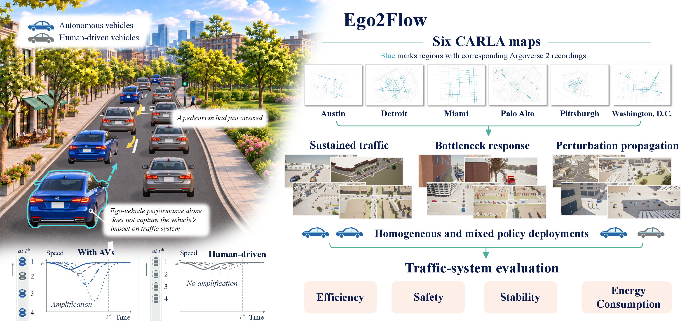

<div align="center">

<h1>Ego2Flow</h1>
<h3>Benchmarking the Traffic-System Impact of Autonomous Driving<br>on Maps Distilled from Real-World Roads</h3>

<p>
<a href="https://arxiv.org/abs/2611.17720">arXiv</a> ｜
<a href="#map-data">Map Data</a> ｜
<a href="https://github.com/Fisher-007/Ego2Flow-Distilled-Map-Generation">Map Generation Code</a>
</p>

</div>

<p align="center">
  
</p>

## Overview

**Ego2Flow** evaluates the effects of driving policies on traffic efficiency, safety, stability and energy use in closed-loop CARLA simulations. It reports eight system-level metrics across 48 scenes on six city maps distilled from real-world roads.

## Map Data

The v1.0 maps are being prepared for release on Hugging Face.

## Installation

Use Linux x86-64 with Python 3.10, CARLA 0.9.16, `taskset` and a Vulkan-capable NVIDIA GPU. Run these commands from the repository root.

```bash
python3.10 -m venv .venv
source .venv/bin/activate
python -m pip install -r requirements/runtime.txt
```

Download map data and see [setup](docs/ENVIRONMENT.md) for installation and environment variables. For LEAD, OneVL, Alpamayo and UniAD, see [driving policies](docs/METHODS.md) for model environments and weights.

### Prepare the scenes

Extract the scene configurations into `configs/scenes/`.

```bash
python evaluate.py prepare
```

## Configure and run

Choose a [runtime configuration](configs/README.md) for your GPU setup.

### One GPU

```bash
cp configs/runtime.sequential.example.json configs/runtime.local.json
```

Set `resource.gpu` and `resource.cpus`. These commands check the setup and run Traffic Manager and IDM-based city by city.

```bash
python evaluate.py doctor --runtime configs/runtime.local.json --methods TM IDM
python evaluate.py run --runtime configs/runtime.local.json --methods TM IDM
```

Each method runs in homogeneous (H) and mixed (M) traffic in every selected scene. Use `--cities PAO` or `--scenes PAO-S01` for a subset. Omit `--methods` to run all methods in the suite.

### Six GPUs on one machine

```bash
cp configs/runtime.parallel.example.json configs/runtime.parallel.local.json
```

Assign each city a GPU, CPU set and base port in `workers`.

```bash
python evaluate.py doctor --runtime configs/runtime.parallel.local.json --methods TM IDM
python evaluate.py run --runtime configs/runtime.parallel.local.json --methods TM IDM
```

### Progress and results

Follow PAO's progress from another terminal.

```bash
tail -f outputs/benchmark/logs/PAO/records.log
```

Resume with the original run command (one-GPU example)

```bash
python evaluate.py run --runtime configs/runtime.local.json --methods TM IDM
```

`outputs/benchmark/report/RESULTS.md` lists each method's eight metric scores, failure fraction and total score. See [output files](docs/OUTPUTS.md) for per-run results and rescoring commands.

## Add a driving method

To add your own policy, follow the [adapter guide](docs/ADAPTERS.md). Sources and licenses are in [third-party components](THIRD_PARTY.md).

## Citation

```bibtex
@article{dong2026ego2flow,
  title={Ego2Flow: Benchmarking the Traffic-System Impact of Autonomous Driving on Maps Distilled from Real-World Roads},
  author={Dong, Yu and Shen, Weiying and Li, Hangyu and Han, Shu and Li, Hong and Gao, Xiangbo and Wu, Keshu and Tu, Zhengzhong and Ahn, Soyoung and Liu, Zhiyuan and Li, Xiaopeng},
  journal={arXiv preprint arXiv:2611.17720},
  year={2026},
  eprint={2611.17720},
  archivePrefix={arXiv},
  primaryClass={cs.RO},
  url={https://arxiv.org/abs/2611.17720}
}
```
